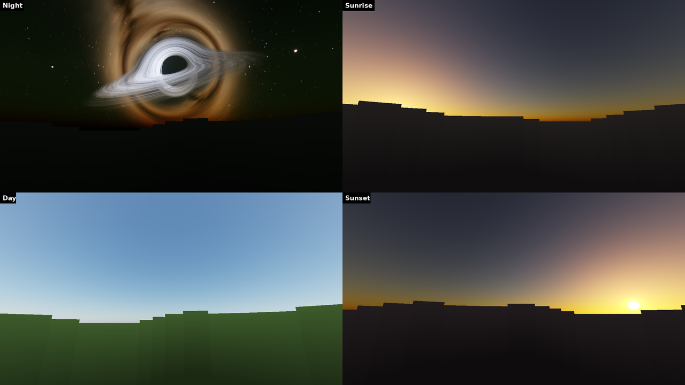
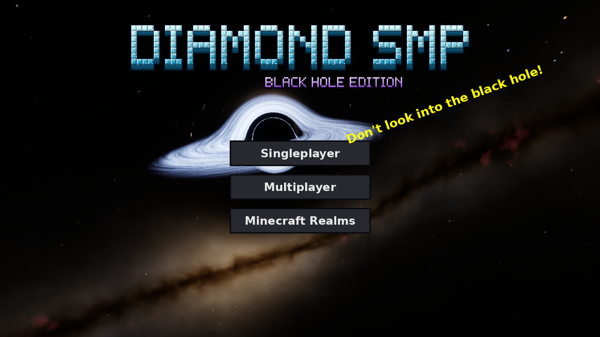
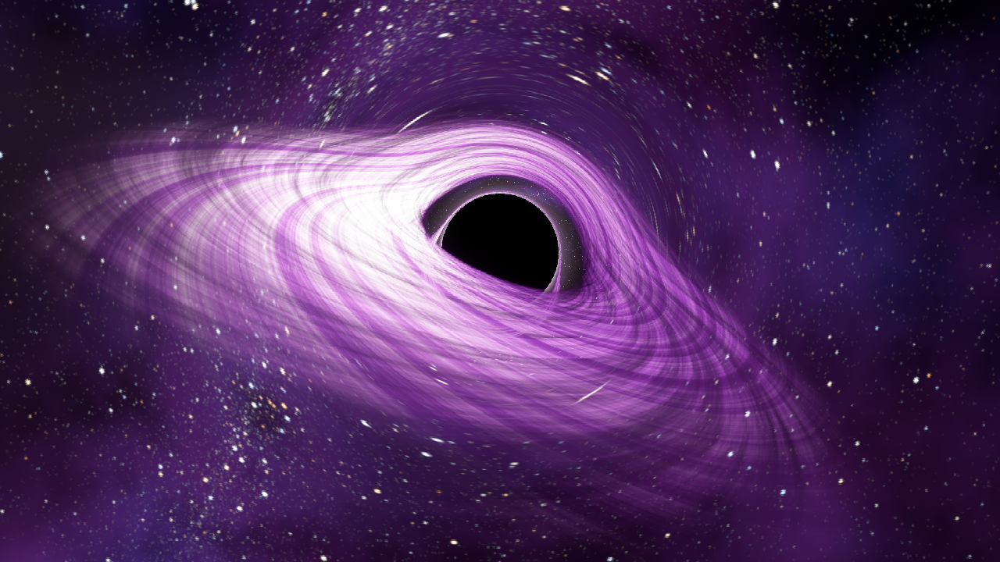
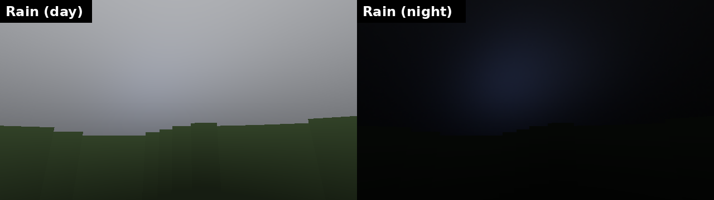
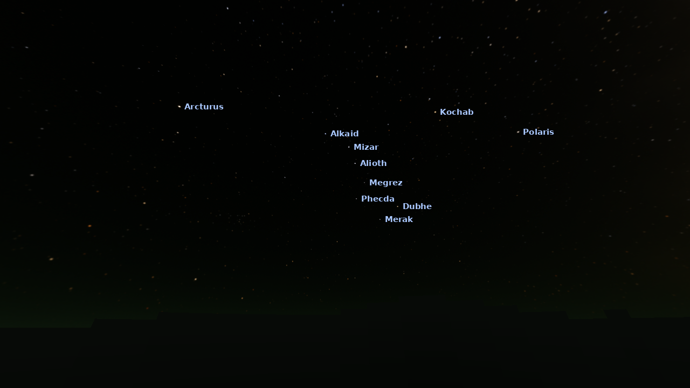
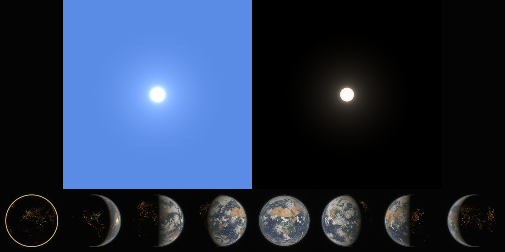
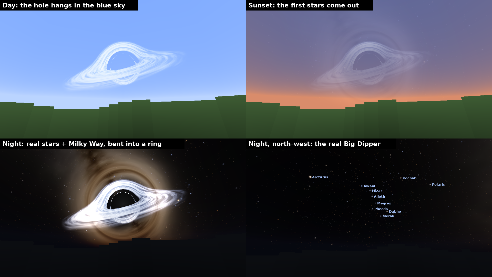
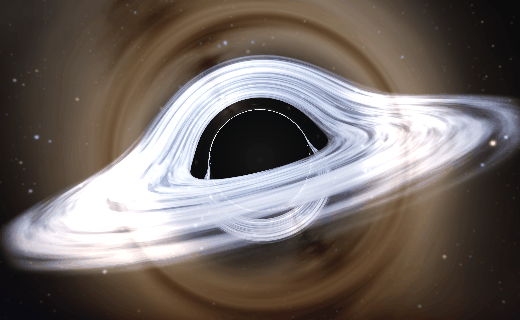
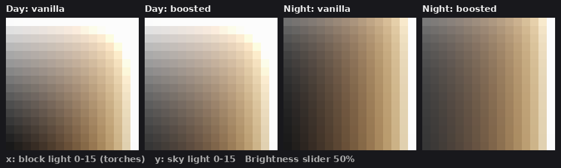

# 💎 Diamond SMP: Black Hole Sky

A vanilla-friendly Minecraft Java resource pack. Blocks, items and mobs keep their vanilla textures. The sky gets **one physically ray-traced, spinning black hole**: Sagittarius A\*, the real black hole at the centre of our galaxy, shown up close. It sits in front of the **real night sky** with real stars and constellations. A real atmosphere renders the day, sunrise, sunset, night and rain around it, with a photorealistic sun and moon.

**Download:**
* [`Diamond-SMP-Black-Hole-Pack.zip`](Diamond-SMP-Black-Hole-Pack.zip): full quality.
* [`Diamond-SMP-Black-Hole-Pack-Lite.zip`](Diamond-SMP-Black-Hole-Pack-Lite.zip): half-resolution skies for low-end PCs and laptops.
* [`Diamond-SMP-Shader-Sky.zip`](Diamond-SMP-Shader-Sky.zip): **new, no mods needed.** A live, animated, ray-traced black hole and the real night sky, drawn by Minecraft's own shaders (1.21.9+). There is also a [Lite](Diamond-SMP-Shader-Sky-Lite.zip) version. See [Shader Sky add-on](#shader-sky-add-on-no-mods).
* [`Diamond-SMP-Light-Boost.zip`](Diamond-SMP-Light-Boost.zip): optional add-on that brightens dark places a little (see [Light Boost add-on](#light-boost-add-on)).



| Title screen | The End |
|---|---|
|  |  |



| Real stars (north-west: Big Dipper, Polaris, Arcturus) | Sun and moon phases |
|---|---|
|  |  |

## What's in the pack

| Feature | Needs |
|---|---|
| **Day / sunrise / sunset / night skies** that cross-fade with the Minecraft clock. The black hole sits due south, 24° up, all day, exactly where Sagittarius A\* really is on a summer night at latitude 37° N. | OptiFine (or Nuit + Nuit Interop) |
| **Rain skies:** overcast by day and night, with the black hole a soft glow behind the clouds | OptiFine (or equivalent) |
| Purple "ender light" black hole over the End | OptiFine (or equivalent) |
| **Live black hole + real night sky with no sky mod:** the disk's gas visibly orbits, and stars twinkle and are bent by gravity | The [Shader Sky add-on](#shader-sky-add-on-no-mods), 1.21.9+ |
| **Photorealistic sun and moon.** The sun is a limb-darkened 5,772 K disc with granulation and glare. The moon is our Moon: real maria and named craters (Tycho with its rays, Copernicus, Plato…), 8 phases lit by the real lunar reflectance law, and faint earthshine. So the sky has exactly **one** black hole. | Nothing, pure vanilla |
| **Title screen:** a slowly spinning black hole with the Milky Way bent around it | Nothing |
| **"DIAMOND SMP" logo** made of diamond blocks, plus a "Black Hole Edition" subtitle | Nothing |
| Custom splash texts, a deep space End sky, and the pack icon | Nothing |

### How realistic is it?

Every pixel is computed from physics, not painted:

* **A spinning (Kerr) black hole:** spin a = 0.9, like Gargantua. Each ray is traced through the exact curved spacetime of a rotating black hole (Boyer–Lindquist geodesics with the Carter constant).
  * Frame dragging makes the shadow D-shaped and shifted.
  * Also exact: the thin photon ring, and the disk's far side lensed over the top and under the bottom.
  * Tested against the analytic Bardeen shadow curve.
* **Real disk physics:** a thin accretion disk reaching down to the spin's innermost stable orbit (2.32 M), with the Page–Thorne temperature profile for a spinning hole (≈26,000 K at its hottest).
  * Each point glows as a true blackbody, converted to color with the CIE 1931 human-eye curves. That's why it's blue-white, like a real hot disk.
  * Exact relativistic **Doppler beaming and gravitational redshift** make the side spinning toward you brighter and bluer.
  * Limb darkening makes the disk dimmer at grazing angles.
* **Real sky:** Rayleigh, Mie and ozone scattering in Earth's atmosphere.
  * That gives the blue day sky, the orange-to-pink sunrise and sunset, and twilight that stays blue overhead.
  * The black hole and stars dim and redden near the horizon, and a soft haze glows around the black hole.
  * By day, sky light fills in the shadow, the same way the Moon's dark side disappears in daylight.
* **The real night sky:**
  * All ~8,800 naked-eye stars of the Yale Bright Star Catalogue (public domain) sit at their true positions and colors for latitude 37° N, with Sagittarius A\* on the meridian. Scorpius and the Sagittarius teapot flank the hole, the Summer Triangle is overhead, and the Big Dipper and Polaris are in the north.
  * Fainter stars follow real counts.
  * The Milky Way runs along the true galactic plane, with its bulge right behind the hole, where it is lensed into a golden Einstein ring. It also has dark dust lanes, pink hydrogen nebulae, and faint airglow at the horizon.
* **Camera optics:** glare around bright light, and a filmic tone curve like a long-exposure astrophoto.

## Install

1. Download the zip (Lite if your PC struggles). **Don't unzip it.**
2. In Minecraft open **Options → Resource Packs → Open Pack Folder** and drop the zip in.
3. Move **Diamond SMP Black Hole Sky** to the right-hand column and click **Done**.

Works on **Java Edition 1.20 → 26.x**.

### Getting the full sky

There are two ways to get the black hole into the Overworld sky. Pick **one**:

* **No mods (Minecraft 1.21.9 or newer, Sodium is fine):** add the [Shader Sky add-on](#shader-sky-add-on-no-mods). It draws the black hole live with Minecraft's own sky shaders.
* **Sky mod (any version from 1.20):** the pack's painted sky layers use the OptiFine custom-sky format.
  * **OptiFine:** Options → Video Settings → Quality → **Custom Sky: ON**.
  * **Fabric / Sodium / Iris:** install **[Nuit](https://modrinth.com/mod/nuit)** and **[Nuit Interop](https://modrinth.com/nuit-interop)**. Nuit Interop loads OptiFine custom skies.

With neither, you still get the photorealistic sun and moon, the black hole title screen, the logo, the splashes and the deep space End sky.

## Shader Sky add-on (no mods!)

[`Diamond-SMP-Shader-Sky.zip`](Diamond-SMP-Shader-Sky.zip) is a small separate pack (190 kB). Put it **above** the main pack. It replaces Minecraft's sky and star shaders, so your graphics card draws the sky live, every frame:





* **The black hole is ray traced on your GPU.** Each sky pixel near it follows a light ray through the curved spacetime of a black hole. That gives the black shadow, the thin photon ring, the far side of the disk bent over the top and under the bottom, blackbody colors, and the Doppler-bright side.
* **The gas really orbits.** Inner gas laps faster than outer gas, like real orbits, driven by the game clock. It stands still when the game is paused.
* **The real night sky replaces vanilla's 1,500 white squares.**
  * The ~900 brightest real stars sit at their true places and colors: the Big Dipper, Scorpius, the Summer Triangle, and the rest.
  * Thousands of fainter stars crowd into the Milky Way, which has dark dust lanes.
  * Stars twinkle, more so near the horizon, where air also dims and reddens them.
  * **Gravity bends all of it.** Stars near the hole are pushed aside, and the bright galactic bulge right behind it wraps into a glowing Einstein ring.
* **It follows vanilla's rules.** The stars fade in at dusk and vanish in rain, exactly when vanilla's would. By day the hole is a pale ghost in the blue, like the Moon. In rain it is a faint glow behind the clouds. Thick fog (water, lava, powder snow) hides it.

**Works with:** Minecraft **1.21.9 to 1.21.11, 26.1, 26.2 and 26.3** (one copy of the shaders per version inside the zip), on vanilla and Sodium. On any other version it does nothing.

**Doesn't work with:** Iris/OptiFine *shader packs* (they replace the whole sky with their own). If you use OptiFine's or Nuit's custom sky, turn that off to see this one, or skip this add-on. Otherwise you'd get two black holes on top of each other.

**Performance:** the black hole is only ray traced where it is on screen, and the stars cost about as much as a light shader effect. On a mid-range graphics card you shouldn't notice it. On a laptop with integrated graphics, use [`Diamond-SMP-Shader-Sky-Lite.zip`](Diamond-SMP-Shader-Sky-Lite.zip). It takes bigger ray steps, uses a simpler Milky Way and drops the faint stars, and looks almost the same. If FPS still drops when you look at the sky, remove the add-on.

**Good to know:**
* If you face *exactly* due east or west (to a hundredth of a degree), the stars briefly fade out, because Minecraft's star matrix can't tell how far up you're looking. Move the mouse a hair and they're back.
* Tested by rendering the shipped shaders in WebGL with vanilla's sky geometry and matrices (that's how the pictures above were made), and by compiling them against every supported version's own shader files. It has not been tested inside the game itself yet. If the sky ever looks wrong, just remove the add-on.

## Light Boost add-on

[`Diamond-SMP-Light-Boost.zip`](Diamond-SMP-Light-Boost.zip) is a tiny separate pack. Put it **above** the main pack. It gently brightens the world, and the darker a spot is, the stronger the boost:

| Spot | Vanilla brightness | With boost |
|---|---|---|
| Full daylight | 0.99 | 0.99 (unchanged) |
| Mid-dark cave (light 7) | 0.41 | 0.45 |
| Pitch black | 0.10 | 0.21 |



It works by patching Minecraft's lighting shader, so it ships one version per shader:
* Supported: **1.21.9 to 1.21.11, 26.1, 26.2 and 26.3**. On any other version it does nothing.
* It switches itself off during the Warden's **Darkness** effect, so it stays fair in PvP.
* It stacks with your Brightness slider.

## FPS: what helps and what doesn't

Straight answer: **no resource pack can give 100x FPS.** FPS is mostly decided by how many chunks, entities and light updates your PC has to draw. This pack's sky costs about the same as the vanilla sky: a few textured boxes. What actually helps:

**1. Mods (biggest win).** Use Fabric with these:

| Mod | What it does |
|---|---|
| **Sodium** | Rewrites the renderer. Often 2–3x FPS or more. |
| **Lithium** | Faster game logic (singleplayer and servers) |
| **ImmediatelyFast** | Faster GUI, text and entity drawing |
| **Entity Culling** | Skips mobs and chests you can't see |
| **FerriteCore** / **ModernFix** | Less RAM, fewer lag spikes, faster startup |
| **Dynamic FPS** | Throttles the game when it's in the background |
| **Nuit + Nuit Interop** | Shows this pack's sky on Sodium |

**2. Settings (biggest single factor: render distance).**

| Setting | Value |
|---|---|
| Render Distance | 8–12 |
| Simulation Distance | 5–8 |
| Graphics | Fast |
| Clouds | Off or Fast |
| Entity Shadows | Off |
| Particles | Decreased |
| Biome Blend | Off |
| Max Framerate | Unlimited |
| VSync | Off |

**3. Your PC:**
* Give Minecraft 4–6 GB of RAM in the launcher (never more than half your total).
* Update your graphics drivers.
* On a laptop, plug it in and force Minecraft (`javaw.exe`) onto the dedicated GPU: Windows Settings → Display → Graphics → High performance.

**4. Use the Lite zip** if you're on integrated graphics or a GPU with little VRAM. It uses a quarter of the texture memory.

**5. The Shader Sky add-on costs GPU time** while you look at the sky (most when the black hole is on screen). If your FPS drops, use its Lite version or leave it out.

## Using it with other packs (like a PvP pack)

Packs stack, so you don't need to merge anything: put **Diamond SMP above your PvP pack** in the resource pack list. Diamond SMP then supplies the sky, sun, title screen and logo, and the other pack supplies everything else.

If you really want one zip, [`generator/merge_packs.py`](generator/merge_packs.py) builds a merged copy into `personal/`, which is git-ignored:

```bash
python generator/merge_packs.py path/to/OtherPack.zip          # or add --lite
# keep vanilla armor + potions from the other pack, add the light boost and the live shader sky:
python generator/merge_packs.py path/to/OtherPack.zip --vanilla armor potions --light-boost --sky-shader
```

`--sky-shader lite` adds the Lite shader sky instead. `--vanilla armor` drops the other pack's armor icons, worn armor, armor glint and trim colors. `--vanilla potions` drops its potion bottles, effect icons, effect backgrounds and potion particles. Without those files, the vanilla look of your Minecraft version shows through.

⚠️ Merged zips are **for your own use**. Many packs (Fortyone included) forbid sharing modified versions, so don't upload one or use it as the server pack without that author's permission.

## Use it as the server resource pack

Everyone who joins gets the pack automatically. Upload the zip somewhere with a **direct, public download link**, then set in `server.properties`:

```properties
resource-pack=https://<direct link to>/Diamond-SMP-Black-Hole-Pack.zip
resource-pack-sha1=<sha1 of the zip>
resource-pack-prompt={"text":"Diamond SMP: enable the black hole sky?","color":"aqua"}
require-resource-pack=false
```

Get the SHA-1 with `sha1sum Diamond-SMP-Black-Hole-Pack.zip` (macOS: `shasum`, Windows: `certutil -hashfile <file> SHA1`).

## Tweaks

All of these are plain-text edits inside the zip, under `assets/minecraft/`.

* **Black hole in deep space all day:** delete `optifine/sky/world0/sky2`–`sky4.properties`. In `sky1.properties`, set `blend=replace` and delete the three `Fade` lines.
* **Change when skies fade:** edit the `startFadeIn` / `endFadeIn` / `endFadeOut` times in `optifine/sky/world0/sky*.properties`. The format is 24h, and 06:00 is sunrise in Minecraft.
* **Keep the vanilla sun and moon:** delete `textures/environment/sun.png`, `textures/environment/moon_phases.png` and the `textures/environment/celestial/` folder.
* **Your own splashes:** edit `texts/splashes.txt`, one per line.

## How it's made

Every texture is generated from scratch by [`generator/`](generator). No Mojang art is used or copied.

* [`kerr.py`](generator/kerr.py): the spinning (Kerr) black hole ray tracer (Numba), with tests against analytic results in `generator/tests/`.
* [`blackhole.py`](generator/blackhole.py): blackbody color science, procedural galaxy, glare and tone mapping (plus the original non-spinning tracer).
* [`real_sky.py`](generator/real_sky.py): the Yale Bright Star Catalogue placed in the Minecraft sky.
* [`celestial.py`](generator/celestial.py): the photorealistic sun and moon.
* [`atmosphere.py`](generator/atmosphere.py): single-scattering Rayleigh, Mie and ozone sky model.
* [`build_pack.py`](generator/build_pack.py): renders every layer and zips the full and Lite packs.
  * Skyboxes are 3072×2048, 2×2 supersampled, and padded so glare is seamless across cube faces.
* [`preview.py`](generator/preview.py): reads the textures back the way the game maps them, to make the screenshots above.
* [`shader_sky.py`](generator/shader_sky.py): writes the Shader Sky add-on's GLSL and checks it.
  * It writes the black hole tracer, an exact gravitational lens table, the star catalogue binned for the GPU, and the Milky Way.
  * It compiles every shader against each supported version's vanilla includes with `glslangValidator`, in Vulkan mode for 26.3.
* [`shader_preview.py`](generator/shader_preview.py): runs those shaders in WebGL (headless Chromium) on vanilla's sky disc and star mesh with vanilla's matrices.
  * It makes the pictures above.
  * `--check` confirms that bright stars land within a pixel of their catalogue positions after lensing.
* [`light_boost.py`](generator/light_boost.py): builds the Light Boost add-on from the vanilla lighting shaders.
* [`merge_packs.py`](generator/merge_packs.py): personal merges with other packs.

Rebuild (about 10 minutes on 4 cores):

```bash
pip install numpy numba pillow
cd diamond-smp-pack/generator
python build_pack.py      # add --quick for a fast low-res draft
python preview.py
python shader_sky.py --preview   # Shader Sky zips + previews (needs node + playwright for the previews)
```
