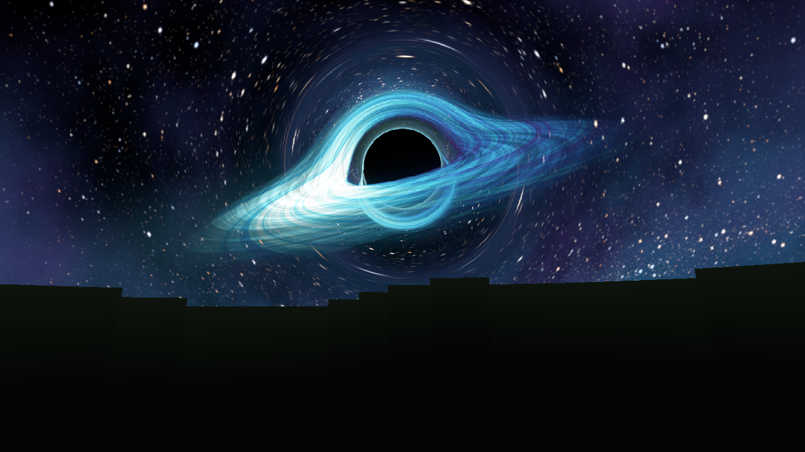
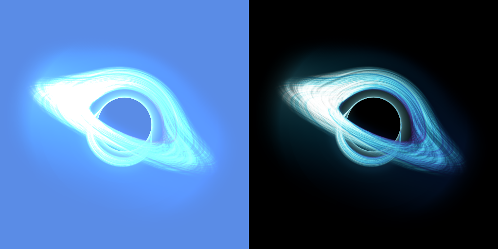

# 💎 Diamond SMP: Black Hole Sky

A vanilla-friendly Minecraft Java resource pack. Blocks, items and mobs keep their vanilla textures. The sky is replaced with a **ray-traced black hole**: a diamond-blue accretion disk bent around the event horizon by real general-relativity light bending.

**Download:** [`Diamond-SMP-Black-Hole-Pack.zip`](Diamond-SMP-Black-Hole-Pack.zip)



| Title screen | The End |
|---|---|
|  |  |

## What's in the pack

| Feature | Needs |
|---|---|
| Full black hole skybox in the Overworld: stars, nebula, gravitational lensing, Doppler-beamed disk. Always visible, day and night, in any weather. | OptiFine (or a Fabric mod that loads OptiFine skies, see below) |
| Purple "void" black hole skybox in the End | OptiFine (or equivalent) |
| Sun becomes a distant diamond-white star, so the sky has exactly one black hole | OptiFine (or equivalent) |
| Distant fog is tinted deep-space navy so the land blends into the horizon | OptiFine Custom Colors |
| **The sun is a black hole.** It rises and sets like the sun, with a glowing disk and photon ring. | Nothing, pure vanilla |
| **Title screen** is a slowly spinning black hole panorama | Nothing |
| **"DIAMOND SMP" logo** made of diamond blocks, with a "Black Hole Edition" subtitle | Nothing |
| **Custom splash texts** ("Don't look into the black hole!", "Spaghettification imminent!", ...) | Nothing |
| **Deep space End sky** (vanilla starfield replacement) | Nothing |
| Pack icon: a pixel diamond inside a black hole | Nothing |



*The vanilla sun texture, shown during the day (left) and at night (right).*

## Install

1. Download `Diamond-SMP-Black-Hole-Pack.zip`. **Don't unzip it.**
2. In Minecraft open **Options → Resource Packs → Open Pack Folder** and drop the zip in.
3. Move **Diamond SMP Black Hole Sky** to the right-hand column and click **Done**.

Works on **Java Edition 1.20 → 26.x**. The pack declares formats 15–999, so newer versions won't flag it as incompatible.

### Getting the full black hole sky

Vanilla Minecraft can't put a texture on the Overworld sky, so the big skybox uses the OptiFine custom-sky format, the standard every sky pack uses:

* **OptiFine:** Options → Video Settings → Quality → **Custom Sky: ON** (and **Custom Colors: ON** for the matching fog).
* **Fabric / Sodium / Iris:** install **[Nuit](https://modrinth.com/mod/nuit)** plus **[Nuit Interop](https://modrinth.com/nuit-interop)**. Nuit Interop loads OptiFine/MCPatcher custom skies.

Without any mods you still get the black hole sun, the title screen, the logo, the splashes and the End sky.

## Use it as the server resource pack

Everyone who joins gets the pack automatically. Upload the zip somewhere with a **direct, public download link** (a GitHub release asset or the raw file URL of a public repo both work). Then set these in `server.properties`:

```properties
resource-pack=https://<direct link to>/Diamond-SMP-Black-Hole-Pack.zip
resource-pack-sha1=<sha1 of the zip>
resource-pack-prompt={"text":"Diamond SMP: enable the black hole sky?","color":"aqua"}
require-resource-pack=false
```

Get the SHA-1 with `sha1sum Diamond-SMP-Black-Hole-Pack.zip` (macOS: `shasum`, Windows: `certutil -hashfile <file> SHA1`). It changes every time the zip is rebuilt.

## Tweaks

All of these are plain-text edits inside the zip.

* **Black hole only at night (OptiFine):** in `assets/minecraft/optifine/sky/world0/sky1.properties`, replace `blend=replace` with:
  ```properties
  blend=alpha
  startFadeIn=17:30
  endFadeIn=19:00
  endFadeOut=06:30
  ```
* **Keep the normal blue fog:** delete `assets/minecraft/optifine/colormap/fog0.png`.
* **Keep the vanilla sun:** delete `assets/minecraft/textures/environment/sun.png` and `assets/minecraft/textures/environment/celestial/sun.png`.
* **Your own splashes:** edit `assets/minecraft/texts/splashes.txt`, one per line.

## How it's made

Every texture is generated from scratch by [`generator/`](generator). No Mojang art is used or copied.

* [`blackhole.py`](generator/blackhole.py) is a Schwarzschild ray tracer compiled with Numba. Each pixel's light ray is traced backwards with the exact photon-orbit equation, so you get the real shadow size, the photon ring, and the disk's far side lensed over the top and under the bottom. The disk is a thin turbulent flow orbiting at relativistic speed. The side spinning toward you is Doppler-boosted bright and blue-white; the receding side fades to violet. Background stars and nebula are lensed too.
* [`build_pack.py`](generator/build_pack.py) renders the OptiFine 3×2 skyboxes (3072×2048, 2×2 supersampled), the six 1024² panorama faces, the sun, the End tile, the pixel-art logo and icon, and zips the pack.
* [`preview.py`](generator/preview.py) reads the textures back the way the game maps them and produces the screenshots above.

Rebuild (about 3 minutes on 4 cores):

```bash
pip install numpy numba pillow
cd diamond-smp-pack/generator
python build_pack.py      # add --quick for a fast low-res draft
python preview.py
```
